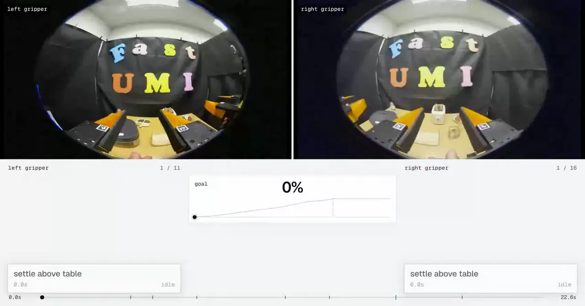

# Argus

[](https://github.com/Pantheon-Industries-Inc/argus/actions/workflows/ci.yml)
[](pyproject.toml)
[](LICENSE)

[Project](https://pantheon.inc/research/argus) | [Example annotations](https://pantheon.inc/data-board) | [Hosted Data Review](https://data.pantheon.inc/review)

### Update v2: Midcentury on WGO-Bench

[Midcentury AI](https://www.midcentury.xyz/blog/optimizing-argus) reported a state-of-the-art result with its adaptation of Argus: **50.2% semantic F1 on WGO-Bench**, using **Sol 6.1 High** in an internal evaluation of 100 videos. Its Argus baseline uses the same model. Other published systems were not rerun through its evaluator, so the published scores are comparison context and do not isolate harness quality.

### Update v1: Format and sensor support

Main now combines source-aware ingestion, depth and tactile reasoning, and consistent failure/recovery rules across teleoperated robots, handheld grippers and human first-person recordings. Long recordings retain one episode and their original clock through bounded model requests; findings, supporting evidence and qualified source claims carry through to the viewer and JSON exports.

## Overview

Argus turns robot-learning recordings into dense annotations of **actions, task progress, failures, recoveries and recording quality**. We believe the combination of broad format support, behavioral annotation and source-verified multimodal reasoning distinguishes Argus among open-source robotics annotation tools. Provide recordings, their recording setup and a short description: the shared pipeline resolves settings and field meanings, checks the data, and lets the model inspect useful evidence without requiring a new annotation prompt for each dataset.


**Recording setups:** teleoperated arms, handheld grippers using the Universal Manipulation Interface (UMI), and human first-person video. **Formats:** LeRobot v2.0/v2.1/v3.0, MCAP, HDF5, video files and folders, and ZIP/TAR archives, with supported JSON/CSV/Parquet sidecars. Nine public dataset adapters also provide download and sample-selection entrypoints.

| Available evidence | How it contributes |
|---|---|
| RGB cameras | Timestamped multi-view grids, first/last frames and relevant boundaries establish actions, progress, outcomes and visible mistakes. |
| Robot state and actions | Declared joints, poses, grippers and control meanings support motion checks and comparison with the footage. Training targets are not automatically treated as commands. |
| Depth | Images and measured regions can establish camera-relative distance or separation where units, calibration and clocks support it. Relative depth stays relative. |
| Tactile | Pressure, normal/shear force, contact arrays and optical tactile images can reveal changes in grip, contact distribution or surface motion. Raw response is not automatically physical force or slip. |
| Other recorded fields | Numeric channels, event flags, native waveform packets and structured metadata can be inspected through the same bounded evidence interface. A recorded sample rate enables spectral analysis; this is not general audio transcription. |
| Publisher context | Instructions, task spans, annotations and calibration retain their source ownership. The model checks claims against observations; missing or conflicting information remains qualified. |

Labels include action phases (advancing, wasteful or idle), subgoals, key events, outcomes, operator mistakes and recoveries, scene changes and recording issues. Sensor conclusions carry evidence, confidence and limitations; ambiguous clocks and unsupported physical claims remain qualified. Inspection may yield no additional finding.

[Format readers](prepare/formats.py) retain source evidence; [field interpretation](label/dictionary.py) resolves meanings and units; [checks](checks) assess recording integrity. Shared [policy](label/policy.py) and [frame planning](label/episode.py) construct requests. When useful, the model [inspects additional evidence](label/evidence_access.py) before [annotation](label/harness.py); [joining](label/pieces.py) restores the original timeline. RGB-only recordings use this same path without requiring extra sensor inputs.

## Install and review

You need Python 3.11, [uv](https://docs.astral.sh/uv/), Node.js for viewer checks, and `ffmpeg`/`ffprobe` 5.1 or newer.

```bash
git clone https://github.com/Pantheon-Industries-Inc/argus.git
cd argus
uv sync --frozen
```

Paid annotation requires `OPENROUTER_API_KEYS` (comma-separated keys) or `OPENAI_API_KEY` in your shell or secret manager. Gated Hugging Face datasets require accepting their terms and setting `HF_TOKEN`. Keep inputs and outputs under the ignored `data/` directory.

```bash
# Prepare and inspect base requests without model calls.
uv run python -m review --data path/to/dataset --rig teleop_arms \
  --dataset-note "Two arms arrange blocks on a tray." --out data/review/mine --free

# Annotate the same job under a spending cap, then open its board.
uv run python -m review --data path/to/dataset --rig teleop_arms \
  --dataset-note "Two arms arrange blocks on a tray." --out data/review/mine --cap 20
uv run python -m board serve --board data/review/mine --clips data/review/mine/clips
```

`--data` accepts a folder, file, archive or HTTP(S) URL. `--rig` identifies the recording setup: `teleop_arms` (robot arms), `handheld_gripper` (UMI) or `ego_head` (human first-person video). Formats and evidence are discovered from the source. Hosted Data Review resolves defaults automatically through the shared policy; its deployed version and upload limits can differ.

| Default or optional setting | Behavior |
|---|---|
| Astra, the default | `openai/gpt-6-astra`, medium reasoning; a regular sample every 1.5s for robot arms, 1s for handheld grippers and 0.5s for human first-person video, plus eligible boundaries and first/last frames. |
| Sol 6.1 High | `--model openai/gpt-6.1-sol --reasoning high`; defaults to 1 FPS on all recording setups and requires at least 1 FPS. |
| Faster actions | `--sample-fps 2` is recommended for subsecond fumbles and rapid recoveries. More images shorten the available request window and can increase cost. |
| Task scope | Source declarations establish episode or session scope. `--task-mode episode` or `session` overrides it; missing instructions alone do not imply a session. Human first-person annotations retain their activities schema. |

One recording remains one public episode. Internal request parts rejoin on its original clock; session tasks annotate activities within it. Explicit preparation limits report trimming; missing parts and processing failures remain visible alongside usable footage and evidence.

Resume reuses recorded settings, source proofs, selected frames and evidence omissions. Changing paid request semantics requires a new run. `--free` skips paid field interpretation, routing and evidence selection; its base requests do not predict later evidence choices. Caps include applicable calls and outstanding reservations; unknown charges remain reserved.

## Results and further use

A review job keeps prepared `episodes/`, base requests in `dry/`, receipts in `run/`, rejoined labels in `run_final/`, and the board. Episode JSON, filtered JSON Lines and static exports preserve annotations and substantive evidence. Public exports withhold private access descriptors and infrastructure paths. Human field interpretations take precedence, including an explicitly blank role; stale findings are withheld when their source or interpretation changes.

The viewer uses the canonical [board/index.html](board/index.html) for live and static pages. It shows behavioral and sensor findings over the footage, with supporting readings and detail available alongside it. Keep uploaded footage under its own access policy and license when sharing.



Animated WebP from the standalone demonstration; the canonical viewer is linked above.

<details>
<summary>Individual stages, dataset adapters and custom boards</summary>

```bash
uv run python -m prepare folder prepare --root path/to/data --rig teleop_arms --out data/episodes/mine/all
uv run python -m checks data/episodes/mine/all
uv run python -m label --dataset mine --episodes data/episodes/mine/all --kind dry
uv run python -m label --dataset mine --episodes data/episodes/mine/all --kind full --cap 20
```

Public adapters are `molmo`, `abc130k`, `galaxea`, `habit`, `fastumi`, `realomin`, `egocentric100k`, `genhumanego` and `openaoe`; `configs/slices/` records published selections. Generic readers preserve source fields instead of applying corpus-release cropping or task selection.

For a custom board, create `data/boards/mine/manifest.json` with the dataset, prepared episodes and run paths. [configs/quickstart/board.json](configs/quickstart/board.json) shows the structure with published-dataset severity rules. Use `python -m board build`, `clips`, `serve`, and `static media`/`static site`; each takes `--help`. Refresh the board after dictionary edits. Owner editing requires `board serve --dictionary-job JOB`.

Paid staged runs require a clean tracked checkout. `--resume RUN --why "reason"` uses saved settings and remaining budget; `python -m label.reparse RUN` reparses stored replies without another call. Receipts survive failures. `board grids` reconstructs base request grids only when original input hashes can be verified; detail/sensor images are counted but not reconstructed there.

`checks.timebase scan` proposes clock corrections; inspect them before `apply`. Capture, source and sensor check failures are distinct from clean results. Optional hand pose uses `board/hand_pose/modal_app.py` and `board/hands.py`; it is separate from ordinary annotation and has the licenses below.

</details>

<details>
<summary>Model comparisons, gate cases and offline verification</summary>

```bash
uv run python -m compare prepare --selection configs/compare/main.json
uv run python -m compare label --selection configs/compare/main.json --models astra,sol61_high --kind full --cap 20
uv run python -m compare board --entries data/runs/compare/main.json --out data/boards/compare
uv run python -m gate prepare
uv run python -m gate label --kind full --cap 20
```

Comparison caps apply per model run and gate caps per recording setup. Sampling may differ by model: compare saved requests before claiming identical inputs. `--with-example` supplies a reference annotation; `--routes` reuses resolution choices. [gate/selection.json](gate/selection.json) and [gate/cases.json](gate/cases.json) define the selected cases; `gate score` evaluates the supplied runs.

`uv run --frozen --offline pytest -q -ra` runs offline tests. CI uses the locked environment, Node, ffmpeg and ffprobe without provider credentials or dataset access. Secret scans cover the committed tree and reachable history; they do not grant permission to publish uploaded data.

</details>

## Credits

The capture checks in `checks/vendor/public_dataset_adapter_qc.py` are Sambhav Gupta's, from public-dataset-adapter (commit 99d0a9e), with the changes listed in that file's header. The hand pose model is ACE-Ego-Hand (Yufei Liu et al., [arXiv:2608.20308](https://arxiv.org/abs/2608.20308)), built on Wan2.2, VideoX-Fun and MANO (Romero, Tzionas and Black, 2017).

## Licenses

The code is Apache-2.0 (`LICENSE`), and the few files that carry material under another license are listed in `THIRD_PARTY_NOTICES.txt`. The components below are downloaded at run time and are not included here. The labels Pantheon publishes, on the data dashboard, in its downloads and in the release, are licensed [CC BY 4.0](https://creativecommons.org/licenses/by/4.0/), so anyone may use them for any purpose with credit to Pantheon. The footage they describe keeps its dataset's license.

| Component | License | Source |
|---|---|---|
| ACE-Ego-Hand code (commit 9757868) | MIT | [github.com/ggxxii/ACE-Ego-Hand](https://github.com/ggxxii/ACE-Ego-Hand/blob/97578680931b3f1c8111396c100d595b98857fb8/LICENSE) |
| ACE-Ego-Hand checkpoints (`ace_ego_hand_k.pt`, `ace_ego_hand_kfree.pt`) | CC BY-NC 4.0, non-commercial | [huggingface.co/acerobotics2025/ACE-Ego-Hand](https://huggingface.co/acerobotics2025/ACE-Ego-Hand) |
| Wan2.2-Fun-5B-Control (weights, VAE, umT5-XXL text encoder and tokenizer) | Apache-2.0 | [huggingface.co/alibaba-pai/Wan2.2-Fun-5B-Control](https://huggingface.co/alibaba-pai/Wan2.2-Fun-5B-Control) |
| VideoX-Fun (commit 968f0e2) | Apache-2.0 | [github.com/aigc-apps/VideoX-Fun](https://github.com/aigc-apps/VideoX-Fun) |
| smplx 0.1.28 | Max Planck license for non-commercial scientific research | [github.com/vchoutas/smplx](https://github.com/vchoutas/smplx/blob/main/LICENSE) |
| MANO (you register and download it yourself) | Max Planck license for non-commercial scientific research, no redistribution | [mano.is.tue.mpg.de/license.html](https://mano.is.tue.mpg.de/license.html) |
| Python packages in `uv.lock` | Each package retains its own license | Package metadata and source distributions |
| MolmoAct2-BimanualYAM-Dataset (Ai2) | Apache-2.0 | [allenai/MolmoAct2-BimanualYAM-Dataset](https://huggingface.co/datasets/allenai/MolmoAct2-BimanualYAM-Dataset) |
| ABC-130k (XDOF) | Apache-2.0 | [XDOF/ABC-130k](https://huggingface.co/datasets/XDOF/ABC-130k) |
| Galaxea Open-World Dataset (Galaxea) | CC BY-NC-SA 4.0, non-commercial | [OpenGalaxea/Galaxea-Open-World-Dataset](https://huggingface.co/datasets/OpenGalaxea/Galaxea-Open-World-Dataset); the adapter reads the copy at `RogersPyke/Galaxea-Open-World-Dataset_10K_20260123`; accept Galaxea's terms on its page before using it |
| HABIT (Config) | CC BY 4.0 | [configinc/HABIT](https://huggingface.co/datasets/configinc/HABIT) |
| FastUMI-100K | Apache-2.0 | [IPEC-COMMUNITY/FastUMI_100k_lerobot](https://huggingface.co/datasets/IPEC-COMMUNITY/FastUMI_100k_lerobot) |
| 10Kh-RealOmin-OpenData (GenRobot) | CC BY-SA 4.0 | [genrobot2025/10Kh-RealOmin-OpenData](https://huggingface.co/datasets/genrobot2025/10Kh-RealOmin-OpenData) |
| Egocentric-100K (Build AI) | Apache-2.0 | [builddotai/Egocentric-100K](https://huggingface.co/datasets/builddotai/Egocentric-100K) |
| Gen-HumanEgo (GenRobot) | CC BY-SA 4.0 | [genrobot2025/Gen-HumanEgo](https://huggingface.co/datasets/genrobot2025/Gen-HumanEgo) |
| OpenAoE-2000h (inclusionAI) | Open-AoE Dataset License, attribution required; its MANO-derived files, which the adapter never reads, also fall under MANO's license | [inclusionAI/OpenAoE-2000h](https://huggingface.co/datasets/inclusionAI/OpenAoE-2000h/blob/main/LICENSE) |

Running a dataset through this pipeline does not change its license, so credit each dataset as its license asks when you publish its footage or labels. The hand keypoints come from the ACE-Ego-Hand checkpoints (CC BY-NC 4.0) and a model built on MANO (non-commercial research only), so use them only for non-commercial purposes and credit ACE-Ego-Hand.
