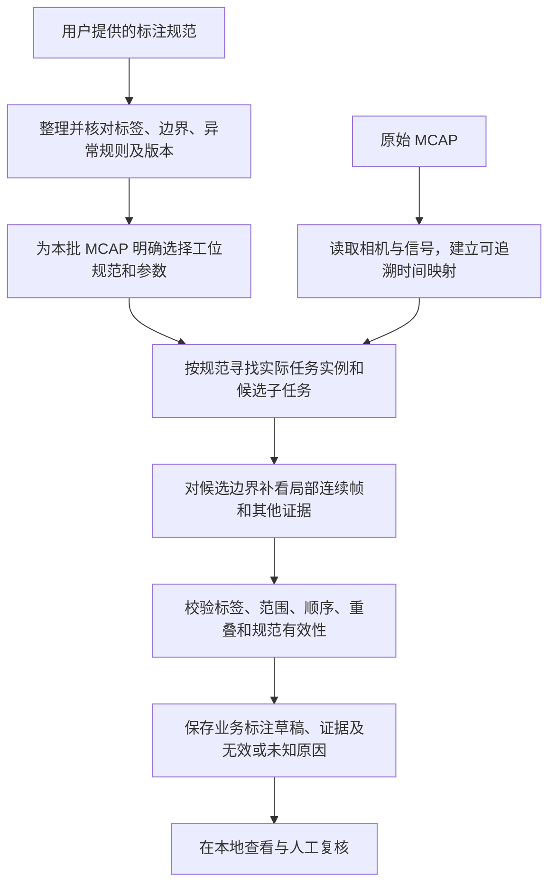

# 01 规范驱动的 MCAP 划分与标注需求

更新日期：2026-10-21。状态：需求理解与实现设计，尚未实现。

## 1. 当前目标和范围

用户希望完善本地 `D:\code\元节智能\ai_Quality_Inspection_Division\argus`：输入 MCAP 和指定的标注规范，让 AI 按规范给出的业务段落、标签、起止条件及异常要求，对录制进行划分与标注。

**规范先定义要找什么、如何切；AI 再根据画面和可用信号确定它实际出现在哪里。**各段名称不由模型自由发明，片段也不能为凑齐标准流程而补造。

本轮范围：

- 业务方案为加热工位 V2 与加小料工位 V2，规则见[配套清单](02_加热与加小料标注规则.md)。
- 当前只在 Argus 中建立需求与设计文档；后续实现优先形成本地可查看、可复核的标注结果。
- 公司平台接入、其他工位和其他开源项目比较不作为当前前置工作。
- 本轮没有修改程序、原始 MCAP 或源 PDF，没有调用模型、训练模型、同步分支或写入公司平台。

“划分 MCAP”先按**在原始时间轴上生成段落范围和标注**理解。是否还要物理导出每段独立 MCAP，当前未明确；不能把 JSON 区间结果称为已生成 MCAP 子文件。若后续需要物理切片，应另行定义 topic 保留、消息时间、视频关键帧依赖及解码验证，原始文件仍保留。

## 2. 现有实现与目标的区别

本次只读核对的本地分支为 `platform`，HEAD 为 `b1e74c40ff1a53fa9320dc95819913d160905ce2`，提交说明为合并上游 `0f6d2e97`。因此历史交接中“尚未合入该上游版本”的状态已经过时。开始时根目录 README 已有未提交修改，docs 为未跟踪目录；本轮保留这些既有内容，不据此推断所有源码与上游完全相同。

| 项目 | 当前代码证据 | 目标适配 |
| --- | --- | --- |
| 数据入口 | [review/__main__.py](../review/__main__.py)、[prepare/formats.py](../prepare/formats.py) 提供转换、检查、标注、board 流程 | 复用 MCAP 解析和证据准备，增加所选业务规范及版本的绑定 |
| 标注粒度 | [label/prompts.py](../label/prompts.py) 的 `LEAN_NOTE` 要求不同动作、抓取、释放等分别成段；`action` 是自由短语 | 增加按规范输出业务子任务的路径，避免原有动作粒度覆盖业务规则 |
| 规范输入 | [label/policy.py](../label/policy.py) 的 `--dataset-note` 是背景说明；[label/episode.py](../label/episode.py) 将其放入录制上下文 | 需要明确的规则加载、验证和固定输出结构，不能把追加说明等同于已实现规则约束 |
| 时间边界 | 原提示词允许在观测时间间插值，要求全程无大段未解释空缺 | 规范边界应有局部帧证据；规范外活动可保留为观察记录，不强塞进合法标签 |
| 结果含义 | 原生 completion 判断、问题标签与业务有效性不是同一套规则 | 分开保存观察到的结果、规范有效性和人工复核状态 |
| 结果解析 | [label/harness.py](../label/harness.py) 有 `normalize_timeline`、`typed_labels` 等原生结构处理 | 业务输出需要独立校验；不能只改 Prompt 而继续假定原解析器支持新字段 |
| 长录制 | [label/pieces.py](../label/pieces.py) 处理技术分块和合并 | 跨块识别同一业务实例，合并后再做范围、顺序和重复校验 |
| 查看结果 | [board/](../board/) 呈现原生标注结果 | 后续需让业务标签、边界证据、无效原因及规则版本可查，不假设 board 已支持 |

设计上区分两类输入：**用户明确选用的标注规范是判断标准；MCAP 自带任务描述、文件名和历史标签是待核实的数据说明。**源文档中的业务条款只用于构建规则，文档内容不会自动成为执行程序或修改外部系统的授权。

## 3. 目标流程

以下是拟议流程，不是现有命令或已可运行模式。

### 3.1 先把文档整理成版本化规则

第一阶段为两份 PDF 整理显式配置即可，不要求先开发通用 PDF 自动理解系统。未来可以让模型辅助提取，但提取结果必须能与源文档的页码、原句和版本对照。

建议每套规则包含：

| 信息 | 用途 |
| --- | --- |
| 规范 ID、业务版本、源文档哈希和适用范围 | 防止新旧规则混用；文件名相同也能区分内容变化 |
| 工位、整体任务定义、执行手臂 | 确定任务范围与主体 |
| 有限的子任务键、模板名称、描述模板 | 输出只能引用合法子任务，避免标签漂移 |
| 每段开始、结束、等待归属和边界证据要求 | 同样的动作按同一口径切分 |
| 正常顺序、已明确的条件分支 | 与真实录制核对，不强行补齐六步 |
| 失败、重复、并行、不可判定和人工介入规则 | 让业务有效性由所选规范决定 |
| 参数及各自含义 | 如勺号和料盒号分别记录，当前方案均为 1，未来允许不同 |
| 未解决的歧义及受影响规则 | 只阻止相关规则自动定案，不能把空缺交给模型随意填补 |

首期建议由用户或作业配置明确选择工位。混合长录制可以先提出工位候选，但工位证据不足时不能自动把所有动作套进已选规范。文件名不能作为任务真值。

### 3.2 识别实际出现的业务实例

- 一份 MCAP 可含一个、多次或不完整的任务实例，不能直接等同“一文件六段”。
- 先按所选规范粗定位，输出合法的子任务键和候选边界；异常活动保留为证据或不匹配记录，不扩充业务标签集合。
- 缺失、未录到、被遮挡、明确不适用是不同情况，应分别记录。未观测到不自动等于动作没发生。
- 重复动作应保留尝试实例。加热多次按键不能只留成功那次；加小料失败后恢复不能自动抹去失败无效规则。
- 技术请求窗口之间传递规则版本、任务实例和边界上下文。窗口切点不当作业务切点，部分处理失败也不当作业务步骤缺失。

### 3.3 边界细化服从规范

粗定位后，在候选开始和结束附近查看连续原始帧、前后状态及其他可用视角。例如：

- 加热 H3/H4：区分最后接触触控板的帧与首次离开的帧，停顿留在 H3。
- 加热 H5/H6：定位右臂持杯准备回退的事件，不能只看左臂是否已经归位。
- 加小料 T3/T4：定位首次向上抬勺，抬勺及之后的转运属于 T4。
- 加小料 T4/T5：确认倾倒或抖料完成、勺头离开并高于杯口，而不只看“勺子在杯上方”。

二分细化仍是可选研究方法：只有目标事件明确、候选区间可信且无多次来回变化时使用；最后补查连续帧。重复按键、短暂离开再接触、遮挡等情形需密集查看或保留不确定范围。加密抽帧或输出帧号不构成精度保证。

### 3.4 时间轴与区间约定

MCAP 包含多条 topic，各相机和状态信号不一定共用时钟或帧率。不能使用“秒数乘 30”作为通用映射。

工程建议：

1. 保留原始消息时间、相机源帧/样本索引、解析后的时间映射与基准。到达时间降级不等于已证明物理同步。
2. 在作业中显式选择参考相机/时间轴，同时保留各证据视角自己的 topic、时间和帧号。参考帧号不是所有相机共同的帧号。
3. 业务段使用 0 起始、左闭右开 `[start_frame, end_frame_exclusive)` 作为拟议内部契约。它是工程建议，尚未确认或实现；不能说成源 PDF 或公司平台的现有约定。
4. 例如最后接触帧为 `k`、首次离开帧为 `k+1`，则按上述契约 H3 终点为 `k+1`（不包含），H4 从 `k+1` 开始；另保留 H3 的最后证据帧 `k`。若中间缺帧或无法确定，保留边界范围而不直接写成精确相邻帧。
5. 转成显示用的首尾包含区间时必须显式转换。结束位点可能等于总帧数，它是边界而不是实际图像帧；终点时间的生成方式也需明确记录。
6. 数据缺帧、不同步或原规范边界冲突时，不允许静默修补时间以通过校验。记录影响及待复核项。

该方案让“两个子任务共享切点”与“同一帧只属于一段”可以兼容；具体采用前仍需与源规范的意图和后续导出要求确认。

## 4. 标注结果与有效性应分开保存

以下是拟议数据契约，不是当前 API 或可直接导入平台的 JSON 定义。

| 层级 | 建议记录内容 |
| --- | --- |
| 作业来源 | MCAP 标识/哈希、规范 ID/版本/源文档哈希/规则配置哈希、参数、代码版本、模型与请求记录 |
| 时间映射 | 参考 topic、时间原点、帧索引起点、区间包含约定、各源数据映射与同步局限 |
| 任务实例 | 独立实例 ID、所选工位、整体范围、实际出现/缺失/不适用步骤、截断及处理完整性 |
| 子任务实例 | 合法子任务键、规范模板名、确定性生成的描述、手臂、勺号/料盒号等对象参数、所属任务及尝试序号 |
| 边界 | 原始时间、参考帧区间、候选范围、是否经局部帧验证、起止规则的来源引用 |
| 观察结果 | 实际动作及物体状态、成功/失败/不可判定、人工介入或空载等事实 |
| 规范有效性 | 有效候选/无效/待明确规则、触发条款、作用时间和范围、是否允许交付 |
| 复核信息 | 是否需复核、原因、证据相机/topic/帧与时间、人工修订及历史版本 |

关键约束：

- “标注正确”与“动作有效”分开。可以正确标出一段抓空，并依据加小料规则判为无效。
- 加小料的“不可判定”按当前规范是无效。复核状态可以同时是待复核，但不能覆盖该无效判定。
- “规则尚未明确”“模型看不清”“文件未成功处理”分别记录，不能统称动作失败。
- 无效结果保留证据和段落，默认不进入有效交付候选；“剔除/无效”的作用单位待确认，不能先删除文件或丢弃记录。
- 模板 ID 暂未提供时使用项目内稳定规则键及精确模板名，外部 ID 留空，不生成假 ID。
- 规范外活动、空档和未处理范围保留在诊断记录中；不要求用合法业务标签覆盖整条录制。
- AI 的置信度只作为辅助信息，不能替代物体状态证据，也不能代替人工审核状态。

## 5. 校验与可追溯要求

### 5.1 可由程序明确检查的部分

- 规范存在且版本唯一；必需参数完整，勺号与料盒号分别取合法值；配置包含源文档引用。
- 子任务键在所选规范集合内，名称和描述中的编号与参数一致。
- 区间有效、处于可读源数据范围内，子任务属于对应任务实例；无证据的精确边界不冒充已验证边界。
- 加小料区间不重叠；共享切点不造成重复帧。顺序异常、重复、缺失明确报告，不通过自动重排或补段来掩盖。
- 分块合并后重新校验实例与时间，不让重叠窗口重复输出同一段。
- 规范、参数或相关输入变化时，失效旧业务标注和相关请求缓存；原始数据准备结果是否可复用另行按依赖判断。

### 5.2 需要视觉/信号证据判断的部分

触发加热是否成功、是否多次按键、左右臂是否同时动作、勺中是否有料、是否进入杯中、是否放稳等，都不能仅靠标签或区间算术确认。应保存直接相关证据及局限。

双臂同时动作与输出区间重叠也不是同一个问题：时间线不重叠不能证明双臂没有同时运动；多视角不同步时不能凭同名帧号认定并行动作。

### 5.3 文档冲突的处理

明确的新修订优先于同文件旧规范；同一有效版本内部存在歧义时，保留冲突和相关候选结果。当前重点是加热 H4 结束、人触发加热分支、共享边界口径、异常排除单位，以及加小料等待归属与表中结束事件的衔接。详细问题已列在[规则清单](02_加热与加小料标注规则.md)，不要求为完成本轮文档先解决全部问题。

## 6. 后续实施顺序

以下均为待办，本轮未执行。

| 阶段 | 工作 | 完成依据 |
| --- | --- | --- |
| 1. 规则配置 | 将两套清单转为结构化配置，加入来源、版本、参数、歧义状态及加载校验 | 可离线查看实际启用的规则，旧五段加热规则不会混入 |
| 2. 受规范约束的标注 | 在 Argus 中新增规范驱动路径，复用解析和证据能力，调整 Prompt、输出结构、解析与请求记录 | 每段关联合法规则，描述编号固定，缺失和异常不被强行补全 |
| 3. 边界与合并 | 局部补帧、时间映射、跨窗口任务合并及校验 | H3/H4、T3/T4 等边界有可回看的连续证据 |
| 4. 有效性与查看 | 将各工位异常规则用于业务判定，在本地结果中展示和保存 | 无效与待明确规则不会被显示为已验收；原因可追溯 |
| 5. 样本评测 | 使用确认过规则的加热、加小料 MCAP，与人工按同版规范复核的结果比较 | 记录边界误差、漏段/多段、无效误放行、人工修改时间和模型成本 |

原生自由标注可保留为诊断或对照路径，但不应作为必须先执行的收费阶段。规范驱动输出可以直接由规则约束产生，避免“先自由切分，再仅把名称替换成业务名称”的伪适配。

## 7. 验证场景与验收口径

规则和结构验证可先使用离线样例；语义效果需要对应工位的真实 MCAP 和人工复核。以前跑过的两份 Realman 录制不能未经核实就充当这两套新规范的验证集。

| 场景 | 应满足的目标 |
| --- | --- |
| 正常加热完整流程 | 按 H1-H6 识别业务段落，不因抓取/释放等原子动作再拆成无关业务标签 |
| 加热按键后停顿再撤离 | 停顿在 H3，H4 从离开开始；H4 终点按确认后的规则判断 |
| 多次按键、双臂同时动作 | 保留事实并触发加热剔除要求，不只保留成功尾段 |
| 人触发加热 | 不补未发生的左臂动作，暴露未明确的分支与边界 |
| 接奶茶数据误选加热规范 | 报工位/任务不匹配，不强制输出六段加热结果 |
| 正常加小料流程 | T3 在抬勺前结束，T4 包含抬勺到倒料后离开杯口，六类标签准确 |
| 当前 1 号和未来不同编号 | 当前 Prompt 明确 1 号；未来勺号与料盒号分别记录且描述一致 |
| 等待、微调 | 依对应规则归属，不生成额外业务标签；存在规则歧义时可见 |
| 加小料抓空、未舀到、洒出、未放稳 | 按规范无效，不能仅因运动路径完整而判成功 |
| 加小料不可判定、空载、人工介入 | 按规范无效并保留原因及证据 |
| 缺步骤、录制截断、重复任务 | 只标真实可定位部分，保留缺失/截断/实例信息，不凑齐六段 |
| 跨处理窗口、缺帧或时间错位 | 不以窗口边界切业务段，不重复计段，不假装已经达到帧级精度 |
| 规则版本更新 | 不复用旧规则的最终标注；保留历史版本便于比较 |

分别统计标签匹配、漏段和多段、起止边界误差（时间及参考帧）、无效误放行/有效误剔除、人工修改时间、总耗时与费用。边界容差、成功率门槛和成本预算尚未指定，不预设数值。评测集按完整录制或采集会话隔离，避免把同次录制的相邻段分进调试与评测两边。

## 8. 当前可继续讨论的事项

两套段落定义已能支撑后续设计，不需要重新从零拟定标签。实现前重点补充：加热 H4 和人触发分支、异常无效的作用单位、参考时间轴及帧区间约定、Home/稳定的判断样例、是否需要独立 MCAP 切片文件，以及用于验证的对应 MCAP。未确定内容保留为明确问题，不在本轮伪装成既定规则。
