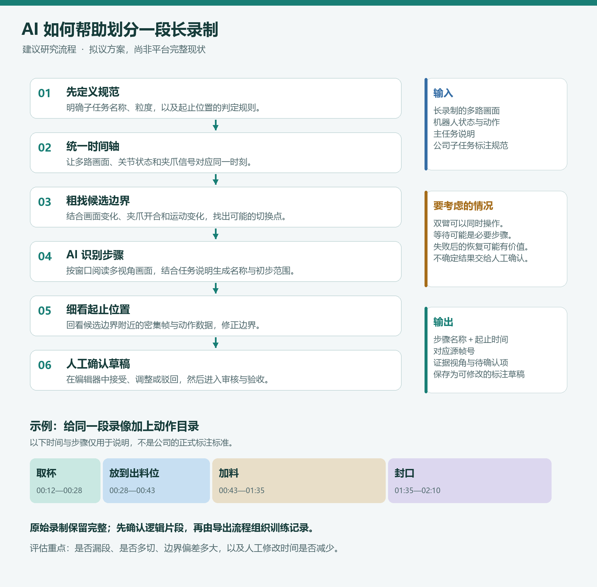

# 04 Argus 方案说明：工作原理与公司数采平台适配

> **2026-10-21 范围更新：**当前仅完善本地 Argus，目标已明确为按用户提供的加热工位 V2、加小料工位 V2 规范，对 MCAP 进行业务段落划分与标注。最新设计见[规范驱动的 MCAP 划分与标注需求](01_规范驱动的MCAP划分与标注需求.md)，具体标签和起止条件见[两套工位规则](02_加热与加小料标注规则.md)。本文保留原理与历史样本；加冰等示例、平台对接和其他项目调研不再代表当前实施范围。新模式尚未实现。

整理日期：2026 年 10 月 15 日  
面向读者：首次接触具身数据标注、AI 划分和质量检查的同事  
研究范围：本地 Argus 源码、公司平台源码，以及本次交流中只读查看的 Realman 数据集样本

> **核心结论：Argus 可以作为“看懂机器人录制、生成动作时间线、寻找疑似问题”的参考基础。公司真正需要的是“按预设业务标签与边界规则，生成可审核的帧级子任务草稿”。两者方向接近，但还需要适配，不能把 Argus 输出直接当作已验收标注。**

本文只整理调研结论，没有修改公司平台，没有运行真实数据的模型评测，也没有调用付费模型。文中的默认配置以本次读取的本地源码为准，不代表上游未来版本。涉及平台的判断区分为“代码中已有”“页面样本可见”和“建议增加”；代码存在不等于线上已经启用。

阅读建议：先看第 1—4 节理解原理和差异，再看第 5—8 节了解如何应用；第 9—11 节用于讨论试点与核对依据。

## 1. 先用一个例子理解目标

机器人完成一次“加冰”，原始数据可能包含头部、左腕、右腕和胸部画面，以及机器人状态、动作和时间信息。

人打开录像后，会划分：

- 子任务 A：倾斜雪克杯，移动到出冰口。
- 子任务 B：从出冰口取回雪克杯，返回 Home。

**AI 要帮忙完成的是：在录制中找到 A 和 B 各自出现在哪里，并按公司的标准标出起止位置。**

这里有三个不同问题：

| 问题 | 通俗解释 | 示例 |
| --- | --- | --- |
| 动作识别 | 发生了什么？ | 右臂正在把杯子移向出冰口 |
| 时间划分 | 从哪里开始，到哪里结束？ | 该样本的子任务 A 是第 19→174 帧 |
| 审核判断 | 划分和操作符合要求吗？ | 标签是否正确、切点是否合适、杯子是否真正到位 |

AI 识别对动作，不代表起止帧也正确；起止帧正确，也不代表这段操作最终成功。

几个常用词：

| 名词 | 在本文中的意思 |
| --- | --- |
| Episode | 一次连续录制；可能包含等待、多个任务或失败重试 |
| Rollout | 机器人按某个策略执行的一段过程及轨迹；可能成功，也可能失败 |
| Task | 一个业务目标，例如“倾倒＋封口” |
| SubTask | 业务目标下的一步，例如“倾倒奶茶” |
| VLM | 视觉语言模型，可以结合画面和文字说明进行判断 |
| Prompt | 给模型的任务说明、判断规则和输出要求，不只是标签名称 |
| 时间戳／帧号 | 时间戳表示何时发生，帧号表示时间轴中的哪个位置；两者需要正确对应 |
| 标注草稿 | AI 的建议结果，尚未代表人工审核或验收通过 |

## 2. 原始 Argus 是什么，完整流程怎样运行？

Argus 是一套围绕模型组织数据和判断流程的软件系统。它本身不是一个独立训练出来的视觉大模型。

可以把它理解成三个角色的组合：

1. **整理材料的人**：读取录像和机器人信号，保留时间关系，准备模型能看的证据。
2. **调用 AI 的助手**：把画面、任务说明和证据交给外接 VLM。
3. **整理报告的人**：保存动作时间线、任务结果、疑似问题和证据，供人查看。

### 2.1 原生处理链路

| 步骤 | Argus 做什么 | 新手理解方式 |
| --- | --- | --- |
| ① 读取数据 | 读取支持的 MCAP、LeRobot、HDF5、视频等格式及可用元数据 | 打开材料，确认有什么 |
| ② 整理与检查 | 整理相机、时间、状态和动作；执行相应数据检查 | 让不同材料能对上同一件事 |
| ③ 准备证据 | 抽取带时间的多视角画面，整理可用状态和传感器信息 | 从长录像中选出可供判断的材料 |
| ④ 模型分析 | 结合任务上下文，识别动作、进度、结果、错误与恢复；符合条件时可追加检查其他证据 | 请 AI 说明“发生了什么、依据是什么” |
| ⑤ 整理时间线 | 将结果整理为动作片段；长录制分批处理后映射回原时间轴 | 把分批阅读的结果放回同一本录像目录 |
| ⑥ 查看和导出 | 在查看器中呈现结果，输出 JSON 等结构化记录 | 让人能定位问题并复核 |

长录制可能因为模型输入限制被分成多个处理窗口。**这些“送给模型的处理窗口”，不是业务子任务。**窗口边缘不能直接当作动作切点。

当前本地 README 列出的证据包括 RGB、多种状态与动作、深度、触觉及其他记录字段。实际能使用哪些证据，取决于数据是否提供、字段含义是否清楚、时间是否可靠对齐。没有触觉数据，就不能凭空获得触觉判断。

### 2.2 输入和输出分别是什么？

**输入通常包括：**

- 录好的数据及相机信息。
- 可用的状态、动作、深度或其他传感器记录。
- 任务指令或数据集说明；缺失时系统需按实际配置理解任务，不能自行假设所有录制都是完整成功任务。
- 数据字段的含义和时间信息，例如哪个信号代表夹爪位置。

**输出可以包括：**

- 动作片段：何时开始、何时结束、哪只手臂、操作什么。
- 子目标与关键事件：到位、抓取、释放、失败、恢复等。
- 任务完成情况及不确定项。
- 疑似数据问题与相关证据。

这里的“动作片段”不自动等于公司数据库中的一条 SubTask，也不自动包含正确的公司模板 ID。

### 2.3 是否需要外接模型、是否需要先训练？

本地版本通过模型 API 完成视觉语言判断。其默认策略配置包含 `openai/gpt-6-astra`，也提供 `openai/gpt-6.1-sol` 的策略；README 说明了 OpenRouter 和 OpenAI 密钥接入方式。这些是本地版本的配置事实，不是本次对模型效果的推荐或排名。

**使用现成模型开始试验，不要求先进行额外后训练。**准备提示词、标签规范和人工示例，不等于训练模型。

对公司场景，先适配模板与证据，再测效果；如果明确存在反复出现、仅靠规则和输入改进仍难解决的问题，再研究微调或专用边界模型。更换 API 模型也需要验证图像能力、接口和输出格式，不能只改名字就假定等效。

## 3. Argus 如何确定“具体在哪一帧切开”？

**准确说，它的主要逻辑是“根据带时间的证据判断动作阶段，输出起止秒数”，不是默认逐帧给每一帧分类。**

### 3.1 先抽样观察，而非默认看完每一帧

本地默认策略中，Astra 配置对双臂遥操约每 1.5 秒选取一个时刻，对手持夹爪约每 1 秒，对第一视角约每 0.5 秒。Sol 6.1 的默认策略为每秒一个时刻。参数可以调整，还可能加入首尾帧和符合条件的额外边界样本。

这些是**观察间隔**，不是最终子任务必须具有的长度，也不是边界误差保证。

### 3.2 AI 根据画面变化提出时间边界

原生时间线包含 `start_s`、`end_s`、`arm`、`action` 等字段。

提示词要求起止时间依据给出的帧时间戳，必要时允许在相邻时间戳之间插值。例如：

| 模型看到的时间 | 画面 |
| --- | --- |
| 3.0 秒 | 杯子还在向出冰口移动 |
| 4.5 秒 | 杯子已经到位 |

AI 可以判断“到位发生在两者之间”，也可能估计为 3.8 秒。**输出了 3.8 秒，不代表模型已经看过并确认了 3.8 秒对应的原始画面。**

### 3.3 动作粒度由提示词引导

Argus 要求按不同动作阶段分段，例如伸手、抓取、搬运、放置、释放、回撤；同一手臂的一段连续动作可以合并。

因此，公司的一条“倾斜就位出冰口”，在 Argus 的动作时间线中可能表现为多条较细的动作片段。反过来，模型也可能遗漏业务上需要区分、但视觉上不明显的阶段。

### 3.4 有补充证据机制，但不能视作逐帧精度承诺

本地版本存在额外证据检查机制，在数据和预算等条件满足时，模型可检查更多记录、样本或图像区域。该机制不能直接等同于“对每个公司子任务边界都逐帧精修”。

本次查看的默认流程，没有显示一个针对所有业务边界、逐帧搜索并保证精确定位的通用步骤。

需要区分：

- **技术上拿到正确时间的帧**：保证给模型看的材料没有取错。
- **语义上判断正确边界**：保证这一帧符合公司的开始或结束规则。

前者可靠，不代表后者必然正确。

### 3.5 改进思路：用二分法细化业务子任务边界

**这是本次讨论提出的待验证方案，不是已经确认存在于原生 Argus 中的功能，也尚未在公司数据上测试。**

这个思路适合接在“粗定位”之后：先找到某个业务子任务边界大致在哪里，再反复把候选范围缩小一半，最后检查附近连续帧。

这里寻找的是**完整业务子任务的开始或结束**，例如“倾斜就位出冰口”何时结束，而不是把每次移动、抓取、停顿都另切成一个子任务。

也要区分：“边界位于一个 1.5 秒间隔内”，不意味着“整个子任务只有 1.5 秒”。一个持续十几秒的子任务，其结束边界也可能落在这样的小区间中。1.5 秒只是沿用前面的采样示例，不是方法必须使用的固定长度。

### 3.6 具体流程：先包围边界，再逐步缩小范围

假设业务人员已经明确了子任务 A 的结束条件，并且经过检查可以确认：

- 3.0 秒处，A 尚未结束。
- 4.5 秒处，A 已经结束。
- 这段范围内只有一个需要寻找的 A 结束边界。

就可以开始查找：

```text
候选范围：[3.0 秒 ────────────── 4.5 秒]
                         ↓
           查看中点 3.75 秒前后的一小段画面
                         ↓
      按公司的结束规则，中点位于 A 结束边界的哪一侧？
           ↙                  ↓                  ↘
       边界之前            边界之后             无法确定
           ↓                  ↓                  ↓
 保留 [3.75, 4.5]    保留 [3.0, 3.75]     补看视角、状态或更多帧
           ↓                  ↓                  ↓
           └─── 对保留范围继续取中点 ───┘   仍不确定则交人工
                         ↓
             缩小到目标范围或相邻几帧
                         ↓
              顺序检查附近连续帧，确认边界
                         ↓
             输出候选帧、判断依据和待复核项
```

例如，3.75 秒时 A 还没结束，就保留后半段，下一轮查看 4.125 秒附近。若发现 A 已结束，就保留前半段。

实际操作可以分为六步：

| 步骤 | 做什么 | 为什么需要 |
| --- | --- | --- |
| ① 明确目标 | 指定任务实例、模板和要找的开始／结束边界 | 避免把“杯子开始移动”和“业务子任务完成”混为一谈 |
| ② 验证范围 | 检查左右端点，必要时补看间隙内画面 | 确认边界确实在里面，没有明显漏掉多次切换 |
| ③ 选中点 | 优先在原始有效帧索引中取中点 | 避免时间取整后反复查同一帧 |
| ④ 判断前后 | 提供规则、中点前后画面和必要的全程上下文 | 让模型看出动作方向及业务阶段 |
| ⑤ 缩小或暂停 | 判断明确才保留一半；不确定就补证据或转人工 | 防止一次错误把真正边界排除在外 |
| ⑥ 最后确认 | 顺序检查附近连续帧，映射到平台帧号 | 形成可定位、可复核的草稿 |

**不建议每轮只看一张中间帧。**单张图能说明杯子的位置，却未必能说明它正在接近还是离开出冰口。应查看中点前后的一小段画面，保留任务说明；多视角和可靠的机器人状态可作为补充。

如果要找一个子任务的开始和结束，应分别建立候选区间。A 的结束不一定等于 B 的开始：公司样本中可能有空档，双臂操作也可能允许重叠，不应强行合并成同一个切点。

2026-10-21 补充：上段是通用场景说明。当前加小料规范明确不允许子任务重叠；加热规范明确剔除双臂同时动作的数据。当前任务必须使用所选规范的约束，不能沿用历史样本的重叠假设。

### 3.7 理论上能缩小多少？什么时候停止？

在每次判断都正确的理想情况下，每进行一次二分，剩余范围减半：

| 二分次数 | 从 1.5 秒开始的剩余范围 |
| --- | --- |
| 0 次 | 1.5 秒 |
| 1 次 | 0.75 秒 |
| 3 次 | 约 0.188 秒 |
| 5 次 | 约 0.047 秒 |
| 6 次 | 约 0.023 秒 |

固定 30 FPS 的一帧约为 0.033 秒，因此理想情况下约六次二分就能缩小到一帧量级。实际应按有效帧数和真实时间戳操作；数据缺帧时，“相邻有效帧”之间仍可能有较大时间间隔。

**缩小搜索范围，不等于同比提高判断准确率。**即使最后只剩一帧，如果前面判断错了，仍然可能切错。原始数据中不存在的画面，也不能通过二分补出来。

建议满足以下任一条件就停止：

- 已达到公司接受的边界范围，或只剩相邻有效帧，转入最后的连续帧确认。
- 已达到预先设定的轮数、耗时或费用上限，保留候选范围。
- 模型反复不确定、前后矛盾，或发现区间内有多次尝试，退出二分并补查。
- 画面缺失或遮挡，无法继续可靠缩小，交给人工判断。

不能因为“已经查了六次”就自动认定精确，也不能把所有结果强制写成一个确定帧号。

### 3.8 适用条件与可能的问题

二分法有一个核心前提：**针对这一次明确的业务事件，沿时间往后，判断应当从“边界之前”变为“边界之后”，而不是反复来回切换。**

例如，“本次正式取回动作是否已经开始”，与“杯子此刻是否正在移动”不是一个问题。杯子可能移动、暂停、再移动；若直接按“是否正在移动”二分，就容易找错位置。失败重试时还要先确定找的是哪一次尝试。

| 条件或问题 | 为什么会影响结果 | 建议处理 |
| --- | --- | --- |
| 边界定义清楚 | “到位”与“接冰结束”可能相差很久 | 先由业务确认规则和人工样例 |
| 区间确实包围边界 | 粗定位错误，后面查得再细也无效 | 检查端点及间隙，必要时扩大范围重新定位 |
| 区间内只有一个目标事件 | 取回、放回、再次取回可能产生多次变化 | 先区分尝试，再分别查找；复杂片段改为连续检查 |
| 中间藏着短子任务 | 相隔 1.5 秒的两张图可能漏掉整个动作 | 对疑似复杂区间补样，不能只靠端点宣称只有一个边界 |
| 遮挡或细微动作 | 单个视角不足以确定发生时刻 | 补其他视角、状态信号，允许回答“无法确定” |
| 模型一次判断错误 | 丢掉的一半可能包含真实边界 | 保留每轮证据；遇到矛盾时回退扩大范围复查 |
| 局部画面缺少上下文 | 同样的姿态可能属于接近、等待或返回 | 保留任务描述、概览和前后动作信息 |
| 多相机时间不齐或缺帧 | 看到的状态可能并非同一时刻 | 先解决时间映射；无法恢复的缺失要明确报告 |
| 边界本身没有唯一答案 | 缓慢过渡、规则不明确时，人工也可能不同意 | 先统一规范；必要时记录可接受范围 |
| 多轮调用成本偏高 | 看图数量减少，不代表总耗时和费用一定减少 | 与一次密集查看短片段的方案做同样本比较 |

特别注意：**只看到区间两端属于不同阶段，并不足以证明中间只发生了一次切换。**这是二分前必须考虑的限制。

### 3.9 如何验证这个思路是否值得采用？

可先对同一组人工确认的业务边界比较三种方式：

1. 只做粗定位。
2. 粗定位后，一次密集查看候选区间的连续画面。
3. 粗定位后，二分缩小范围，再检查最后附近的连续帧。

比较起止边界误差、漏掉的业务步骤、人工修改时间，以及模型调用次数、总耗时和费用。对于只有约 1.5 秒的小区间，一次密集查看可能比多轮二分更简单；对于较大的候选范围，二分可能更有价值，实际效果需要测量。

建议把它定位为**第 7 节“边界细化”步骤的一种可选方法**：条件明确时使用二分，证据不足时补查或转人工。它不会自动补齐业务标签、边界规范、数据对齐和审核规则。


## 4. 与公司需求的主要区别

| 对比点 | Argus 原生侧重点 | 公司当前需求／建议目标 | 适配工作 |
| --- | --- | --- | --- |
| 标签 | 结合证据生成动作描述，可使用任务上下文 | 提前设置标准 Task/SubTask 模板 | 限定候选标签，保留模板关联 |
| 粒度 | 动作阶段、关键事件与行为分析 | 加冰、搅拌、倾倒封口中的业务步骤 | 把动作阶段映射到业务定义 |
| 边界标准 | 判断动作变化并给出时间 | 按公司规范确定起止帧 | 明确规则，在候选边界附近细看 |
| 时间表示 | 以起止秒数等时间信息表达 | 平台使用起止帧，并显示时间 | 统一时间原点、帧索引和多视角对齐 |
| 中间空档 | 要求无大的、未解释的时间线空缺 | 某些业务标注允许留出区间 | 分开处理“分析全程”与“选入训练的区间” |
| 回 Home | 根据上下文分析动作贡献 | 部分模板明确包含回 Home | 不可统一删除复位或归位动作 |
| 失败重试 | 可描述错误与恢复 | 按业务规范决定保留、拆分或退回 | 不强行凑齐模板步骤 |
| 质量判断 | 输出问题、结果和证据 | 支持公司审核、验收及原因记录 | 建立检查项和人工处理入口 |
| 交付结果 | 查看器与结构化分析记录 | 可修改、可追溯的标注草稿 | 转换成平台结构，接入已有工作流 |

这里的“预设标签”不应理解为“强制每条录制输出一模一样的步骤”。即使标准流程有五步，真实录制也可能只完成三步、重复第二步，或者出现计划外动作。AI 应记录实际情况并提出复核项。

## 5. Realman 样本告诉了我们什么？

以下来自本次交流中已查看的页面样本，**不是对整个空间的统计，也不是 AI 预测结果**。帧范围按页面记法保留；相邻片段共用边界的存储／导出包含规则仍需单独确认。

| 数据集与样本 | 页面所见划分 | 对方案的启示 |
| --- | --- | --- |
| ice-1012；Episode `20261012_170536_837871` | 加冰 Task：19→259；倾斜就位出冰口：19→174；取回雪克杯：174→259 | 同一 Task 下有两条业务子任务；不能把 174 当作其他录制的固定切点 |
| 搅拌-0930；Episode `20260930_150008_448934` | 搅拌 Task：5→359；切入搅拌器：5→212；从搅拌器返回 Home：212→359 | 返回 Home 是该任务有效标注的一部分 |
| 工位5-20261012；Episode `20261009_164847_522086` | 倾倒＋封口：伸杯 12→96、倾倒 96→253、右臂回 Home 253→301、放杯入封口机 301→471、取封口杯 687→882 | 有五步，也存在 471→687 的未选入子任务区间 |
| 工位5-倒奶茶-1002；Episode `20260930_162208_681027` | 完整 Task 预览中，放杯 335→504、取杯 730→1011；所查看的数据集列表主要展示倾倒条目 | 数据集可以选择完整任务中的部分子任务；列表不是录制全貌 |

对第三、第四行的空档，页面能证明“未被这些子任务覆盖”，但仅凭区间不能断言全部是等待封口，更不能据此制定全公司的排除规则。

其他需要注意的事实：

- 数据集成员数是集合内条目数量，不能直接当作独立 Episode 数量。
- 数据集状态与子任务状态是不同层级。例如数据集可为 draft，而其中所查看条目为 accepted。
- 预览中出现“Primitives（未拆分）”，不能据此认为已经有更细原子动作的人工真值。
- 已验收样本可作为讨论材料，但单个样本不能代替统一的边界规范。

## 6. 预设标签之外，还要准备什么？

只有标签名称，AI 仍然会面临歧义。例如“倾斜就位出冰口”的结束，是杯子到位，还是接冰结束、准备取回？

需要把每个模板写成一张简短的规则卡。

| 规则项 | 要回答的问题 |
| --- | --- |
| 模板名称及 ID | AI 的输出对应平台哪一个模板？ |
| 动作定义 | 哪只手臂，对什么物体，完成什么目标？ |
| 开始条件 | 以什么可观察事件作为开始？ |
| 结束条件 | 以什么可观察事件作为结束？ |
| 等待与归位 | 等待是否计入？回 Home 是否计入？ |
| 异常处理 | 动作缺失、重复、失败、恢复怎么标？ |
| 双臂关系 | 是否允许同时发生、时间重叠？ |
| 证据与样例 | 哪个视角或信号最有帮助？有哪些人工确认样本？ |

**用于讨论的示例，不是已经确认的公司规范：**

- 标签：“从出冰口取回雪克杯”。
- 候选开始条件：接冰后，右臂开始持续将杯子移离出冰位置。
- 候选结束条件：回到规定 Home 区域，并满足公司定义的稳定状态。
- 待确认：接冰是否有可用事件信号？开始时的轻微调整算不算取回？Home 依据视觉位置还是机器人状态判断？稳定要求是什么？

规则中的“到位”“稳定”“完成”必须由业务人员说明，并配真实样例。不要凭空替公司设定运动阈值、等待时长或固定帧数。

提示词可以组织成“任务背景＋允许标签＋边界规范＋异常处理＋输出格式”。平台模板 ID 由程序提供和校验，避免让模型编造。

## 7. 建议的适配流程：先粗找，再细看，再生成草稿

2026-10-21 补充：当前改为“标注规范 → 版本化规则 → MCAP 证据 → 按规则定位与细化 → 校验和本地草稿”。下面的平台模板和审核链路是历史扩展方案，当前不以修改公司平台为前提；具体规则不再只停留在待拟定的示例卡片。

下面是**建议增加的公司适配方案**，不是宣称 Argus 或公司平台已经完整实现。

```text
录制数据 + 平台任务模板 + 人工边界规范
                    ↓
检查数据是否可读，统一多视角与状态时间轴
                    ↓
粗看全程：寻找任务、子任务和候选转折位置
                    ↓
细看候选边界：增加附近连续画面，结合可用状态证据
                    ↓
按业务规则确认区间，保留不确定和异常说明
                    ↓
把时间对应到平台实际帧索引
                    ↓
检查标签、父子范围、顺序、遗漏及不合理重叠
                    ↓
生成 AI 草稿与证据
                    ↓
标注员修改确认 → 审核 → 验收 → 组织数据集并导出
```

此前调研中的通用动作划分图可辅助阅读；它也是建议流程，不是 Argus 的原生架构图：



### 7.1 粗找与细看的分工

粗找负责回答“取回杯子大约发生在哪里”；细看只针对附近的一小段连续画面，回答“哪一刻符合开始规则”。这样可以集中处理边界，不必一开始就将长录像的所有帧全部送入模型。

增加采样密度能提供更多证据，但不保证一定达到某个帧级精度。遮挡、动作模糊和规则不清仍会影响结果。

### 7.2 时间与帧号的对应

多相机可能有各自时间戳，平台还可能使用统一参考时间轴。应先明确 AI 所用时间的原点，再对应到平台帧索引。

“秒数 × 30”只有在已确认固定 30 FPS、时间起点一致、索引规则一致等条件下才适用。不能把它当作所有 MCAP、视频和平台记录的通用换算。

还需确认：

- 索引从 0 还是 1 开始。
- 起止边界的包含规则。
- 相机缺帧时如何映射。
- 相邻子任务共享边界时，导出是否重复或遗漏数据。

### 7.3 建议保留的结果

| 信息 | 用途 |
| --- | --- |
| Episode、Task 和模板关联 | 知道结果属于哪份录制、哪种业务任务 |
| 子任务模板、描述与顺序 | 对应公司的标准标签 |
| 起止时间和平台帧号 | 编辑器能准确定位 |
| 支持判断的视角、时间点及简短理由 | 审核员能核实 |
| 不确定项与异常类型 | 说明哪些地方需要重点检查 |
| 模型、规则版本与输入记录 | 便于比较、复现和追踪 |

以上是建议的数据契约，不是现成 API 字段清单。不要将模型自报的置信度直接当成正确概率。

## 8. 如何接入目前公司平台？

### 8.1 已有基础与仍需补齐的部分

| 项目 | 当前依据 | 对接时应做什么 |
| --- | --- | --- |
| Task/SubTask | 模型已有描述、起止帧和模板相关字段 | 复用已有业务层级 |
| AI 草稿 | 现有服务读取画面、调用 VLM、解析并写入 `llm_draft` | 可研究沿用草稿入口承接新分析结果 |
| 草稿应用 | 已有替换或追加任务的应用逻辑 | 明确人工确认、已有标注保护与冲突处理 |
| 模板关联 | Task 有 `template_id`，SubTask 有 `initial_template_id` 等字段 | 显式适配模板；所查看的 AI 草稿应用代码没有写入这些模板字段 |
| 多视角与抽样 | 已查看链路包含主相机选择，默认最大抽帧数为 60 | 核实实际部署路径，增加需要的多视角和边界证据 |
| 默认提示词 | 内置内容偏向 pack items 食品装袋任务，包含固定 30 FPS 表述 | 不能直接当作 Realman 奶茶业务规范；自定义配置与真实调用也需核实 |
| 审核、验收 | 代码中已有分开的角色与处理流程 | AI 结果交由原有流程确认 |
| 训练集输出 | 平台已有数据集组织与导出能力 | 经确认后再按交付要求使用 |

现有提示词要求动作边界在上下 3 帧内定位，这只是要求，不能证明当前抽样和模型已经达到该精度。

**建议将 Argus 作为可替换的分析模块来试验。**平台继续管理录制、任务、人员、模板、审核状态和导出；中间增加转换逻辑，将 Argus 的分析结果转换为公司需要的草稿。

### 8.2 标注、质检和验收要分开设计

| 层次 | 要检查什么 | 适合的手段 |
| --- | --- | --- |
| 原始数据质量 | 文件可读性、时间连续性、缺帧、信号缺失、画面问题 | 明确规则检查，必要时结合视觉模型 |
| 标注质量 | 标签是否正确、边界是否合理、是否漏段 | 业务规则、模型证据与人工复核 |
| 操作结果质量 | 是否抓空、放错、未完成、失败后恢复 | 多视角、状态信号和任务上下文 |
| 最终验收 | 是否符合本批次交付要求 | 公司制定标准，由现有验收流程确认 |

一段操作失败的数据也可能被正确标注，并适合用于某些训练或分析目标。因此，“操作失败”“标注错误”“数据不可用”不能划等号。

平台已有 SARM 相关质量分析路径，可研究与 Argus 互补：例如进度模型提供疑似停滞位置，VLM 结合画面解释。其任务和权重适用范围需要独立验证，本文不把它视为通用自动验收能力。

## 9. 第一阶段如何验证，不急着训练或改平台

2026-10-21 更新：第一阶段围绕已提供的加热、加小料两套规范准备对应 MCAP 和复核样例。此前以加冰试点、扩展搅拌和倾倒封口的建议保留为历史背景，不再作为当前任务顺序。当前验证场景见[新需求第 7 节](01_规范驱动的MCAP划分与标注需求.md#7-验证场景与验收口径)。

| 阶段 | 工作 | 可交付结果 |
| --- | --- | --- |
| ① 定规范 | 和标注、审核人员确认标签及边界规则 | 模板规则卡、人工确认样例 |
| ② 准备样本 | 包含正常、等待、遮挡、重试、缺失和双臂并行等情况 | 用于调提示词的样本及独立评测样本 |
| ③ 比较方案 | 对比原生 Argus、加入业务约束、再加入边界细化 | 同一组样本上的差异记录 |
| ④ 评估收益 | 比较人工修改量、耗时及错误 | 是否值得进入平台适配的结论 |
| ⑤ 再决定实现 | 根据剩余问题决定接口适配、专用模型或微调 | 有依据的开发范围 |

同一 Episode 中相邻片段很相似，划分调试样本和评测样本时，应避免把它们随意拆到两边，导致高估效果。

建议记录这些指标：

- **标签正确率**：选对了哪个业务子任务。
- **遗漏和多切情况**：有没有漏掉真实动作，或编出不存在的步骤。
- **起止边界误差**：分别统计帧数和时间误差，以及在公司容忍范围内的比例。
- **异常漏检与误报**：真正的问题有没有找到，正常片段是否被误判。
- **人工修改时间**：使用 AI 草稿后是否实际更省时。
- **处理耗时与模型费用**：每条录制的成本是否可接受。

边界容忍范围应由业务需求确定。只比较模型之间答案是否一致，不能代替与人工规范的比较。

## 10. 尚需业务确认的问题

2026-10-21 更新：两套工位的标准子任务、绝大部分起止条件和多项异常规则已由附件明确。下面是历史通用问题，不应再次把全部内容当作尚未提供；当前只需继续核对[规则清单中的具体缺口](02_加热与加小料标注规则.md)。

历史问题：

1. 每种 Task 的标准子任务列表是什么，是否有多个合法流程？
2. “接冰完成”“回到 Home”“放置完成”等事件怎样定义？
3. 等待、失败尝试和恢复动作是否纳入训练片段？
4. 哪些双臂动作允许重叠？哪些任务必须有先后关系？
5. 平台帧号对应哪条时间轴？相邻区间的边界如何包含？
6. 模型无法确定时，是保留候选范围，还是必须交人工划分？
7. 验收所关注的是标签、动作成功、数据质量，还是这些条件的组合？

## 11. 证据与阅读入口

### 11.1 本地 Argus 依据

本地仓库：`D:\code\元节智能\ai_Quality_Inspection_Division\argus`。本次没有固定到经验证的 Git 提交号；复现实验时应另行记录提交号、模型和规则版本。

| 文件 | 对应结论 |
| --- | --- |
| [README.md](../../argus/README.md) | 输入格式、证据种类、API 接入、查看器、长录制处理和默认策略 |
| [label/policy.py](../../argus/label/policy.py) | 模型及默认采样配置，采样频率参数 |
| [label/prompts.py](../../argus/label/prompts.py) | 动作时间线字段、允许时间插值、动作阶段粒度和覆盖要求 |
| [label/frames.py](../../argus/label/frames.py) | 帧提取与时间对应 |
| [label/episode.py](../../argus/label/episode.py) | 模型输入材料、采样及部分额外边界证据 |
| [label/evidence_access.py](../../argus/label/evidence_access.py) | 符合条件时检查其他证据及其限制 |
| [label/harness.py](../../argus/label/harness.py) | 模型调用和证据检查编排 |
| [label/pieces.py](../../argus/label/pieces.py) | 长录制的处理分块与结果组织 |

官方入口：[Argus 仓库](https://github.com/Pantheon-Industries-Inc/argus)、[项目介绍](https://pantheon.inc/research/argus)。本文具体实现判断以本地源码为主，未在本次整理中重新验证公开网页的最新内容。

### 11.2 公司平台依据

公司仓库：`D:\code\元节智能\data_label_platform`，仅只读分析。

| 文件 | 用途 |
| --- | --- |
| [任务模型](../../../data_label_platform/data-label/backend/app/models/task.py) | Task/SubTask、帧范围及模板关联 |
| [AI 标注服务](../../../data_label_platform/data-label/backend/app/services/llm_annotator.py) | 默认提示词、模型调用和草稿解析 |
| [AI 草稿接口](../../../data_label_platform/data-label/backend/app/routes/llm.py) | 草稿读取与应用，模板映射尚需适配的依据 |
| [抽帧服务](../../../data_label_platform/data-label/backend/app/services/media/video/frame_extractor.py) | 抽帧、相机选择与部分时间换算 |
| [配置](../../../data_label_platform/data-label/backend/app/core/config.py) | 默认抽帧参数 |
| [审核验收接口](../../../data_label_platform/data-label/backend/app/routes/review.py) | 审核与验收流程 |
| [SARM 说明](../../../data_label_platform/docs/data-quality-sarm.md) | 已有质量分析方向 |

页面样本入口：[ice-1012](http://123.57.7.62/datasets/67)、[搅拌-0930](http://123.57.7.62/datasets/62)、[工位5-20261012](http://123.57.7.62/datasets/66)、[工位5-倒奶茶-1002](http://123.57.7.62/datasets/57)。这些页面需要相应平台访问权限，内容可能随业务操作变化。

前置阅读：[具身数据 AI 标注与质检：基础调研](03_具身数据AI标注与质检_基础调研.md)。其中的市场实例属于此前调研记录；本文主要补充 Argus 的机制、公司样本差异与适配方案。
